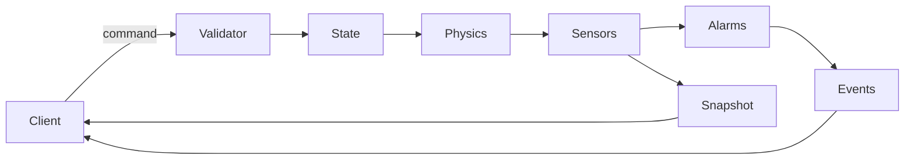

# RBWR Unit 2 API Overview

## Scope

The engine owns plant state, control validation, automatic state evolution, annunciator transitions, and persistence. A client renders values supplied by the engine and never derives a gauge or alarm.

The current transport executable is a newline-delimited JSON diagnostic adapter. It is intentionally deterministic and suitable for headless tests. A network WebSocket/REST adapter can wrap the same `rbwr_core` API without changing simulation behavior.

## Data flow

## Time and determinism

`step(dt_seconds)` advances simulation time only when the engine is running. The engine increments its tick once per accepted step and scales simulation time by `speed`, clamped to `0.1..20.0`. Wall-clock time is not used by the process model. Identical initial state, commands, timestep, and configuration produce identical snapshots on the same platform.

## Roles

`observer` can request read-only protocol operations. `operator_role` can operate plant controls. `instructor` additionally controls simulation state and malfunctions. Invalid role or control operations return machine-readable error codes.

## Fidelity classes

- **(a)** deterministic bookkeeping and protection rules, such as tick progression and bus interlocks.
- **(b)** reduced-order process correlations, such as condenser pressure and reactor pressure response.
- **(c)** gameplay-tuned values used to make the training workflow observable.

The implementation is an educational/game simulator, not a licensed safety-analysis code.